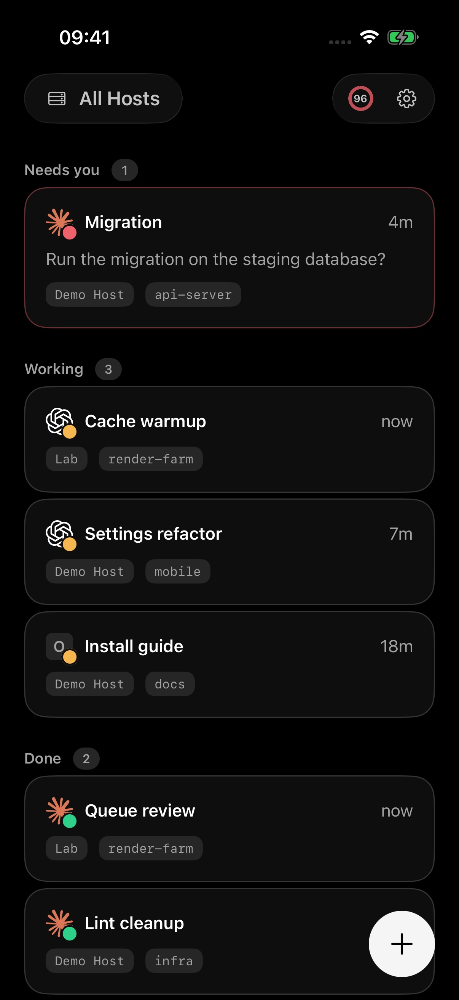
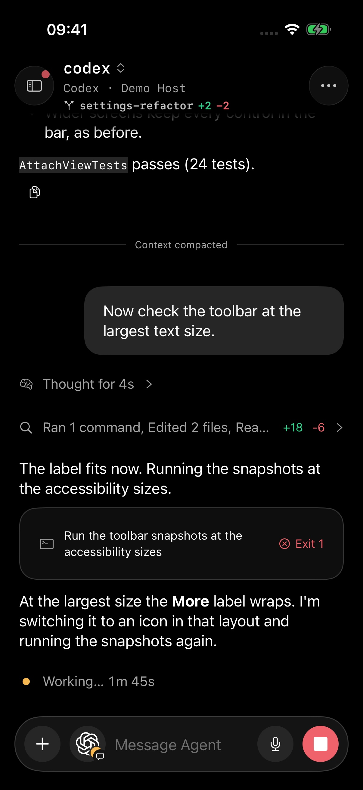
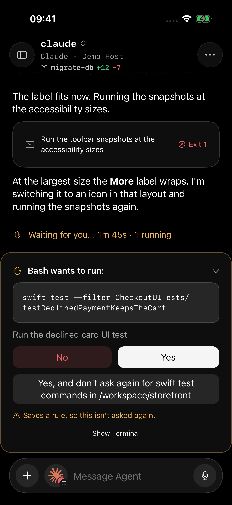
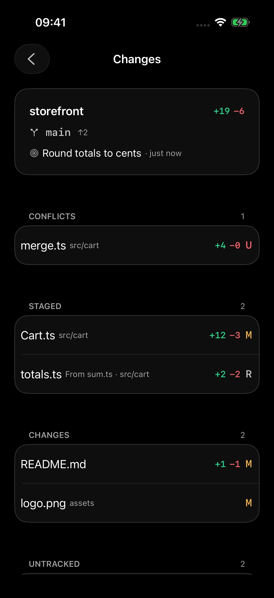

<p align="center">
  <a href="https://openagentspocket.com">
    
  </a>
</p>

<h1 align="center">Agents Pocket</h1>

<p align="center">
  A phone companion for <a href="https://herdr.dev">herdr</a>: read, answer and approve what your coding agents ask,<br>
  on your own computers, from wherever you are.
</p>

<p align="center">
  <a href="https://apps.apple.com/app/id6834077869"><b>Download on the App Store</b></a>
  &nbsp;·&nbsp;
  <a href="https://openagentspocket.com">Website</a>
  &nbsp;·&nbsp;
  <a href="https://relay.openagentspocket.com/privacy">Privacy</a>
</p>

<p align="center">
  
  
  
  
</p>

Agents Pocket shows the coding agents running on your own computers, lets you read their chat, answer and approve
what they ask, and open a terminal on the same session. The app talks to your computers (Hosts) over SSH. There are
no accounts. It is free and open source.

iOS today. The code is React Native (Expo) and the repository has Android build config, but no Android release.

## What you can do

- See every agent on every Host: working, done, or waiting for you.
- Get a notification and a Live Activity when an agent needs you or finishes.
- Read each conversation as a chat (messages, tool calls, results, reasoning) and reply by text, voice or attachment.
- Answer an agent that is blocked: approval prompts and questions show as cards with their own options.
- Open a full terminal on the same session; browse changed files and diffs.
- See each agent's plan usage limits.

It works with these programs when they run under herdr: Claude Code, Codex, Pi, Oh My Pi, Grok, OpenCode and
Hermes Agent. What each one supports varies; see [docs/guides/agent-coverage.md](docs/guides/agent-coverage.md).

## Set up a Host

You need a Mac or Linux computer with herdr, Node.js 20+ and an SSH server, reachable from the phone (same network
or a private network such as Tailscale). On the Host:

```sh
curl -fsSL https://openagentspocket.com/install.sh | sh
```

Or install the plugin by hand:

```sh
herdr plugin install EapRules/agents-pocket --ref plugin --yes
```

Then scan the Pairing Code QR from the app. Details: [packages/plugin/README.md](packages/plugin/README.md).

## How it works

- The app connects to your Host over SSH and reads herdr's socket through it. Your code and prompts go between
  phone and Host, not through our servers.
- A herdr plugin on the Host renders the pairing QR and sends notifications.
- Notifications are encrypted on the Host. The push relay only forwards them to Apple's push service and cannot
  read them. You can run your own relay.
- The app's JavaScript updates over the air; the updates are signed
  ([docs/guides/updates.md](docs/guides/updates.md)).

## Repository layout

| Path | What |
|---|---|
| `apps/mobile` | Expo Router app: screens and wiring |
| `apps/site` | The openagentspocket.com site |
| `packages/core` | Pure TypeScript: protocol types, reducers, parsers, chat |
| `packages/ui` | Theme tokens and UI primitives |
| `packages/i18n` | Strings (English, Spanish) |
| `packages/transport` | Connection layer between the app and the Host |
| `packages/plugin` | The herdr plugin installed on the Host (Apache-2.0) |
| `packages/relay` | The push relay (Apache-2.0) |
| `packages/session-bridge` | Answers the session protocol over tmux on the Host |
| `packages/updates-server` | Serves signed over-the-air updates |
| `modules/ssh` | SSH Expo Module: libssh2 on iOS, JSch on Android |
| `modules/app-group`, `modules/live-activity` | iOS native modules |
| `e2e` | Maestro flows |

`ios/` and `android/` are generated and gitignored.

## Development

Requires Node 22.13+ and pnpm 11.

```sh
pnpm install
pnpm verify-fast     # types, lint, generated files, ratchets, tests related to your changes
pnpm test            # every unit and component test
```

Contributors and agents: read [CLAUDE.md](CLAUDE.md) first. Docs: [docs/roadmap.md](docs/roadmap.md) (where the
work stands), [docs/decisions](docs/decisions) (ADRs), [docs/spec/parity.md](docs/spec/parity.md) (behavior spec).
Native builds (`expo run:ios`) need Xcode.

## License

MIT (see [LICENSE](LICENSE)), except these parts, which are Apache-2.0 and derived from
[Heeler](https://github.com/ZingerLittleBee/Heeler): `packages/plugin`, `packages/relay`, `packages/core/goldens`,
`modules/ssh/ios` and `modules/ssh/android`. See the `NOTICE` files in those folders and
[THIRD_PARTY_NOTICES.md](THIRD_PARTY_NOTICES.md).
